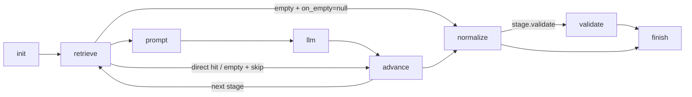

# ActionPack unified extract (as-built + DTO / LangGraph design)

| Field | Value |
|-------|--------|
| **Status** | Working — legacy script path and the LangGraph/Pydantic graph path (§5) are both implemented |
| **Audience** | Engineers extending per-field extraction across corporate actions |
| **Harness (previous)** | [`scripts/eval_unified_field_qwen.py`](../scripts/eval_unified_field_qwen.py) — being edited separately; **not** ported to the graph (see §5.7) |
| **Harness (graph)** | [`scripts/eval_unified_field_graph.py`](../scripts/eval_unified_field_graph.py) — same CLI and outputs, drives `src/evaluation/extract/` |
| **Graph layer** | [`src/evaluation/extract/`](../src/evaluation/extract/) |
| **Packs** | [`src/evaluation/action_packs/`](../src/evaluation/action_packs/) |

This is the canonical doc for the scored extract path. Related GT / samples / preprocess docs are linked at the end.

---

## 1. Design goal

- **Harness stays fixed** — load artifacts, build evidence, call LLM, soft-match score.
- **ActionPack is swappable** — schema (`fields`), definitions, hints, temporal cues, and clause policies live in the pack.
- **Do not bake tender strings into the harness** — event-specific patterns and copy prompts belong in packs (tender today; merger next).

Available packs: `tender`, `merger` via `get_pack(name)`.

---

## 2. As-built architecture

Sections 2.x describe the legacy script path. The graph path (§5) reproduces it per field behind typed DTOs.

```text
GT row (accession)
  → event_id (documents.parquet)
  → preprocess artifacts (segments, concise rep, GLiNER spans)
  → ActionPack field loop
       ├─ clause_fields[field]?  → retrieve_clause → field extract_prompt → LLM
       └─ else oneshot / cascade → RULES + GLiNER + TEMPORAL evidence → pick prompt → LLM
  → soft_match vs gold
```

### 2.1 Core types

Defined in [`src/evaluation/action_packs/base.py`](../src/evaluation/action_packs/base.py):

| Type | Role |
|------|------|
| `ActionPack` | `fields`, `field_defs`, `field_pick`, `hint_allow`, `date_fields`, `temporal_cues`, `validate_fields`, `clause_fields`, `system_prompt`, `normalize` |
| `ClauseFieldSpec` | Pack-tunable long-form field: passage quotes → regex windows → `extract_prompt` |
| `PackHooks` | Optional pack-specific evidence logic (§5.4) |
| `policies` | Optional explicit per-field `FieldPolicy` (§5.3); empty = derive from the knobs above |

`date_fields` gates temporal NER: non-date fields never load the tagger or get TEMPORAL evidence.

### 2.2 Extract paths

**Clause path** (oracle-style; used for tender `proration_terms` today):

1. GT passage quotes for `quote_field` (if present and accepted by `quote_accept_re`).
2. Else regex `patterns` over passage text ∪ segment blob ∪ excerpts (~`max_chars`, default 2200).
3. Whitespace collapsed so SEC line-breaks still match (`pro rata`).
4. LLM sees pack `extract_prompt` (“copy the oversubscription sentence…”).
5. If retrieve is empty → **`clause_miss`** → pred `null` (no GLiNER fallthrough).

Implementation: [`retrieve.py`](../src/evaluation/action_packs/retrieve.py) + clause branch in `extract_field` in the harness.

**Oneshot / cascade path** (other fields):

- Evidence pack from RULES facts, GLiNER spans (`hint_allow`), and temporal DATE spans (`temporal_cues`).
- Generic pick prompt from `field_defs` / `field_pick`.
- `--no-cascade` = oneshot mixed evidence; cascade = Pass A rules → Pass B spans → optional Pass C validate.

### 2.3 Tender proration pack knobs

In [`tender.py`](../src/evaluation/action_packs/tender.py), `clause_fields["proration_terms"]`:

- Patterns: `If more than…` / `Shares in excess of…` / `pro rata` / `proration` / `oversubscription` (fixed-width windows; not period-terminated, so `i.e.` cannot truncate).
- Prompt: copy trigger + allocation from EXCERPT only; do not invent % or infer from purchase cap alone.
- Normalize: strip thousands commas for soft-match.

**Coverage note:** if preprocess segments are cover/letter-only and lack the Offer-to-Purchase proration sentence, retrieve correctly returns empty (`clause_miss`). That is upstream artifact coverage, not a pack-prompt failure.

---

## 3. Baselines and current Orin numbers

Constants in the harness:

| Baseline | Micro F1 | Meaning |
|----------|----------|---------|
| Oracle routing | **0.837** | Best-per-field mix (rules / temporal / Qwen / Llama clause) |
| Hybrid GLiNER + Qwen all-spans | ~0.48 | Span-heavy baseline |
| Orin Gemma oneshot (limit-20 verify) | **~0.64** | `gemma4:26b`, reasoning off, concurrency 4 |

Artifacts:

- Oracle assembly: `outputs/tender_eval/experiments/runs/best_per_field_effective_gt_prompt.json`
- Plot: `outputs/tender_eval/figures/13_oracle_vs_orin_oneshot_f1.png`
- Oneshot run: `outputs/tender_eval/experiments/runs/verify_c4_reasoning_none_limit20/`

### Why oracle (weaker models) beats Gemma oneshot

Oracle is **better evidence + task shape**, not a bigger model:

| | Oracle (e.g. Llama 8B clauses, Qwen 4B) | Orin Gemma oneshot |
|--|------------------------------------------|--------------------|
| Proration | Regex/GT clause in context → copy | GLiNER `proration*` spans often **empty** → null |
| Effective date | Temporal + accept/reject cues | Noisy dates + “pick something” → FP flood |
| Job | Copy / abstain from the right window | Hunt answer in the wrong bag |

Clause pack path for proration is the same idea: when the sentence is in segments, Gemma recovers it (probe: 3/3 hits → TP; 4/7 still `clause_miss`).

---

## 4. How to run

From repo root (Orin hub via `OLLAMA_HOST` in `.env`):

```bash
.venv/bin/python scripts/eval_unified_field_qwen.py \
  --pack tender \
  --backend orin \
  --model gemma4:26b \
  --split holdout \
  --no-cascade \
  --limit 20
```

Useful flags: `--pack merger`, `--fields core`, `--validate` / `--no-validate`, `--no-temporal`.

The graph harness takes the same flags and writes the same outputs: swap in `scripts/eval_unified_field_graph.py`.

Scoring: `soft_match` in [`src/evaluation/tender.py`](../src/evaluation/tender.py). Holdout membership: `ensure_holdout` under the run's `--out` (`outputs/tender_eval/` for tender, `outputs/merger_eval/` for merger).

---

## 5. Graph architecture: DTOs + LangGraph (per-field) — as built

One compiled LangGraph per `(pack, backend, provider)`, invoked once per **field**. The holdout loop stays outside the graph (`scripts/eval_unified_field_graph.py`: build request, `run_field`, `soft_match`). Design record and deviations: [superpowers/specs/2026-11-13-extract-graph-dto-design.md](superpowers/specs/2026-11-13-extract-graph-dto-design.md).



### 5.1 Package layout

| Path | Role |
|------|------|
| [`src/evaluation/extract/dtos.py`](../src/evaluation/extract/dtos.py) | Frozen Pydantic v2 DTOs |
| [`.../policies.py`](../src/evaluation/extract/policies.py) | `Stage`, `FieldPolicy`, `resolve_policy`, `DIRECT_RULES_FIELDS` |
| [`.../evidence.py`](../src/evaluation/extract/evidence.py), [`prompts.py`](../src/evaluation/extract/prompts.py), [`temporal.py`](../src/evaluation/extract/temporal.py) | Evidence-line builders, prompt builders, default temporal tagger |
| [`.../providers.py`](../src/evaluation/extract/providers.py) | `EvidenceProvider` protocol, `EventContext`, `ArtifactProvider` |
| [`.../state.py`](../src/evaluation/extract/state.py), [`graph.py`](../src/evaluation/extract/graph.py) | Graph state; `build_extract_graph`, `run_field` |
| [`.../nodes/`](../src/evaluation/extract/nodes/) | `retrieve`, `prompt`, `llm`, `normalize` (init/advance/normalize), `validate` (validate/finish) |
| [`src/evaluation/action_packs/base.py`](../src/evaluation/action_packs/base.py) | `ActionPack` (+ `policies`, `hooks`), `PackHooks` |
| [`tests/evaluation/extract/`](../tests/evaluation/extract/) | Policy, graph, hook, new-pack, CLI and legacy-parity tests |

Dependencies: `langgraph`, `pydantic>=2.5` (in `requirements.txt`). No tender or merger strings in graph, DTO or node code.

### 5.2 DTOs

All frozen Pydantic models; no ad-hoc dicts across node boundaries.

| DTO | Fields |
|-----|--------|
| `FieldExtractRequest` | `pack_name`, `field` (non-blank), `event_id`, `accession`, `model`, `validate_enabled`, `cascade` |
| `EvidenceBundle` | `text`, `source` (`clause` \| `rules` \| `gliner` \| `temporal` \| `mixed`), `n_chars`, `empty` |
| `FieldExtractResult` | `pred`, `pass_used`, `n_evidence_chars`, `n_rules`, `raw_llm`, `validate_verdict` |

`req.accession` doubles as the provider's context key (§5.5). Any exception in `run_field` becomes `pass_used="error"`.

### 5.3 `Stage` / `FieldPolicy`

`FieldPolicy` is an ordered tuple of `Stage`s plus `stop_at_first_hit`. Both are frozen **dataclasses**, not Pydantic (a field named `validate` would shadow `BaseModel.validate`). A `Stage` carries `sources` (`clause`, `rules`, `gliner`, `temporal`, `prior`), `prompt_mode` (`copy` \| `pick`), `on_empty` (`null` \| `skip` \| `ask`), `pass_label`, `null_label`, `direct_from_rules`, `validate`, `direct_label`, `empty_label`.

With `stop_at_first_hit=True` (every derived policy) the first stage that produces a value ends the policy. With `False`, later stages still run: a later hit replaces the earlier one, a later null never erases it, and `evidence_final` (used by Pass C and `n_evidence_chars`) stays the evidence of the stage that produced `pred`. An empty stage with `on_empty=null` ends the whole policy even when later stages remain. `Stage` rejects `direct_from_rules=True` unless `sources` is `("rules",)` or `("prior",)`.

`resolve_policy(pack, field, cascade=...)` returns `pack.policies[field]` if set, else derives the legacy behaviour:

| Legacy behaviour | Derived policy |
|------------------|----------------|
| Clause field (`clause_fields`) | One stage `clause`: sources `clause`, `copy`, `on_empty=null`, empty label `clause_miss` |
| Oneshot (`--no-cascade`) | One stage `oneshot`: `rules`+`gliner` (+`temporal` for date fields), `pick`, `on_empty=ask` |
| Cascade | Stages `rules` (Pass A) then `span` (Pass B: `gliner` (+`temporal`)), `on_empty=skip`, B labelled `B` / `B_null` |
| Cascade, pack has `hooks.direct_prior` | Extra leading stage `prior` (label `hooks.prior_label`, merger `A_inventory`), skipped at run time when `direct_prior(field, extras)` is `None` |
| `DIRECT_RULES_FIELDS` (ticker, cusip, isin) | `direct_from_rules=True` on the `rules` stage |
| Pass C validate | `Stage.validate`, set to `field in pack.validate_fields` on every derived stage; the node gate is `policy.stages[pred_stage].validate` (the stage that produced `pred`) |

### 5.4 Pack hooks

`PackHooks` (optional, `ActionPack.hooks`) holds pack-specific evidence logic so the graph stays generic. `extras` is `EventContext.extras`, a `Mapping[str, str]` that `ArtifactProvider` fills by calling the pack's `extras_from_inventory` hook on the event's `inventory.json` (merger: `primary_entity`, `is_proxy_filing`); packs without that hook get `{}`.

| Hook | Purpose |
|------|---------|
| `junk_roles` | Role nouns (e.g. "parent", "purchaser") dropped from GLiNER spans; tender and merger both set this to preserve legacy behaviour |
| `drop_span(field, text, extras)` | Drop a span |
| `rules_prelude(field, extras)` | Extra RULES lines prepended. Without a matching `direct_prior`, cascade Pass A runs on prelude-only evidence |
| `direct_prior(field, extras)` | Value trusted before any LLM pass (merger inventory primary entity); labelled `prior_label` |
| `synth_spans(field, gliner_lines, spans, extras)` | Extra evidence lines when GLiNER lines are empty |
| `prior_label` | `pass_used` for a prior hit (default `A_inventory`) |
| `prior_hint` | `hint=` name on the evidence line of a prior hit, `RULES:\n- hint=<prior_hint> value=...` (default `prior`; merger `primary_entity`) |
| `extras_from_inventory(inventory)` | Builds `EventContext.extras` from the event's `inventory.json` dict (`{}` when missing or unreadable) |

### 5.5 Providers

`EvidenceProvider` is a protocol: `context(req)`, `bundle(ctx, field, sources, pack)`, `rules_direct`, `n_rules`. `ArtifactProvider` implements it over preprocess artifacts plus GT passages. Pack- and harness-specific behaviour is injected, never hard-coded:

| Callable | Role |
|----------|------|
| `event_id_for(row)` | GT row to preprocess event id (pack-specific lookup) |
| `temporal_for(event_key, excerpts, date_fields)` | Per-field temporal lines, always requested for every `pack.date_fields` entry (so a `--fields` subset run never caches a partial file); defaults to running the tagger without a cache. The graph harness injects a disk cache (`<out>/temporal_cache/<pack>/<event_key>.json`) |
| `key_for(row)` | Context cache key; default is the row's accession. Must equal the string the harness puts in `req.accession` |

### 5.6 Graph nodes and parity

`init` resolves the policy and loads the context, then per stage: `retrieve` (build the `EvidenceBundle`, or short-circuit on direct/prior/empty), `prompt` (copy or pick prompt), `llm` (`backend.chat_json`), `advance` (next stage or finish). Then `normalize` (`pack.normalize`), optional `validate` (Pass C keep-or-null), `finish` (build `FieldExtractResult`). Compile once, invoke from many threads.

**Parity guarantee:** `tests/evaluation/extract/test_parity_legacy.py` runs the graph and a vendored legacy reference, [`tests/evaluation/extract/legacy_extract.py`](../tests/evaluation/extract/legacy_extract.py), over synthetic fixtures and real preprocess artifacts (tender and merger, oneshot and cascade, validate on and off) with a scripted backend, and asserts identical `pred`, `pass_used`, `n_evidence_chars`, `n_rules`, `raw_llm` and the same sequence of prompts sent. The reference is a frozen copy of `extract_field` and its helpers from the 2026-11-13 snapshot of `eval_unified_field_qwen.py` (kept at [`tests/evaluation/extract/fixtures/legacy_harness_snapshot_20261113.py.txt`](../tests/evaluation/extract/fixtures/legacy_harness_snapshot_20261113.py.txt)). If a test disagrees with it, fix the graph, not the reference.

**Drift test:** `test_live_script_has_not_drifted_from_snapshot` compares the source of `extract_field`, `build_evidence`, `_gliner_lines`, `_rules_lines` in the live script against the snapshot. It is `xfail(strict=False)`: it flags drift for review (re-baseline or port) and does not fail the suite.

### 5.7 Harnesses and known gaps / reconcile

The graph matches the **frozen 2026-11-13 snapshot**, not the live `scripts/eval_unified_field_qwen.py`, which is being edited separately. Differences to reconcile before treating the two harnesses as interchangeable:

- `max_gliner_lines` / score-sorted GLiNER spans (graph keeps the snapshot's fixed cap and order).
- Fine-tuned GLiNER candidates (not read by the graph).
- `ticker` dropped from the direct-rules fields in the live script (graph still has `DIRECT_RULES_FIELDS = {ticker, cusip, isin}`).
- Merger "No stock consideration" handling moved into the prompt in the live script (graph keeps the snapshot behaviour).

When porting any of these, update the graph, regenerate the parity fixtures/snapshot, and the drift test will go green.

### 5.8 Add a new corporate action

1. Write `src/evaluation/action_packs/<name>.py` defining an `ActionPack`: `fields`, `field_defs`, `field_pick`, `hint_allow`, `gt_to_hint`, `date_fields`, `temporal_cues`, `validate_fields`, `clause_fields` (long-form fields), optionally `policies` (explicit `FieldPolicy` per field) and `hooks` (`PackHooks`).
2. Register it in `get_pack` in [`src/evaluation/action_packs/__init__.py`](../src/evaluation/action_packs/__init__.py).
3. Run `scripts/eval_unified_field_graph.py --pack <name> --gt <gt.csv> --out <eval_dir> ...`. Packs without an entry in the script's `HARNESS_CONFIGS` must pass both `--gt` and `--out` (the script exits 2 otherwise) and resolve preprocess event ids from the GT row's `event_id` column; add a `HarnessConfig` entry for default paths, a custom event-id strategy or party-name scoring fields. No graph, DTO or node edits. [`tests/evaluation/extract/test_new_pack.py`](../tests/evaluation/extract/test_new_pack.py) shows a pack added this way.

Caveats:

- GT rows that share an accession but carry different passages need per-row context keys: pass a `key_for` that returns a unique string and put the same string in `req.accession` (`ArtifactProvider.prepare` raises on a clash). The graph harness already does this.
- Per-event data a pack's hooks need (merger: `primary_entity`, `is_proxy_filing`) travels in `EventContext.extras`; `ArtifactProvider` fills it from the pack's `extras_from_inventory` hook (a custom provider must populate it itself).
- A `rules_prelude` without a `direct_prior` makes cascade Pass A run on prelude-only evidence.

---

## 6. Related docs

| Doc | Role |
|-----|------|
| [tender-gt-schema.md](tender-gt-schema.md) | Tender GT columns and join rules |
| [tender-sample-extraction-guide.md](tender-sample-extraction-guide.md) | Sample corpus structure / GLiNER routing notes |
| [../notebooks/evaluation/evaluation_readme.md](../notebooks/evaluation/evaluation_readme.md) | Early StackAI reference-dataset workflow |
| [eval-merger.md](eval-merger.md), [../mergers_extraction/README.md](../mergers_extraction/README.md) | Merger eval / oracle windows |
| [lld-preprocess-pipeline.md](lld-preprocess-pipeline.md), [../preprocess/README.md](../preprocess/README.md) | Upstream artifacts the harness reads |
