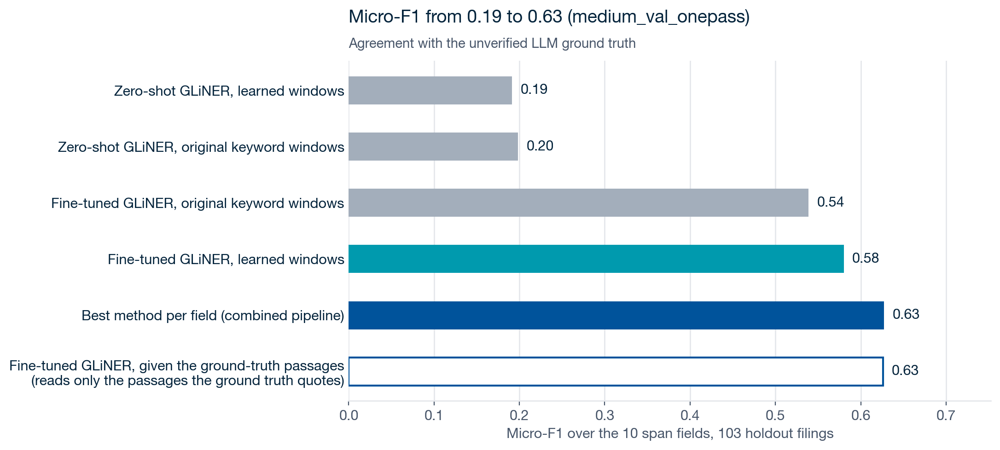
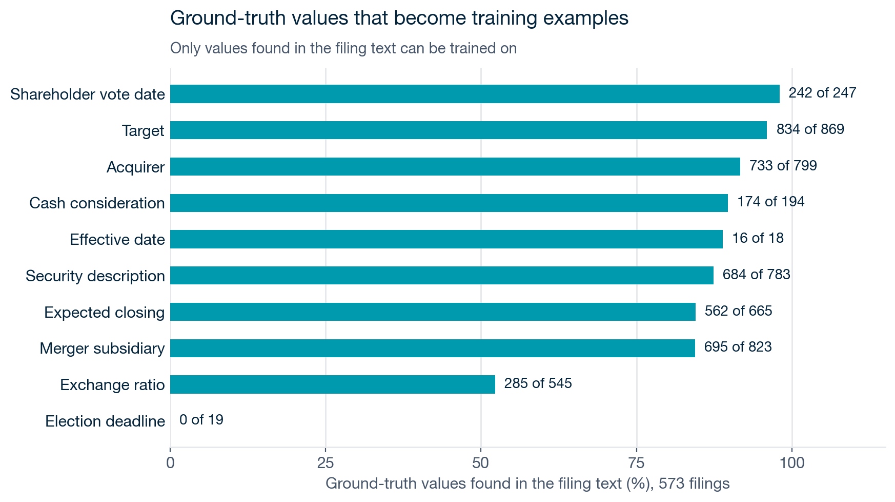
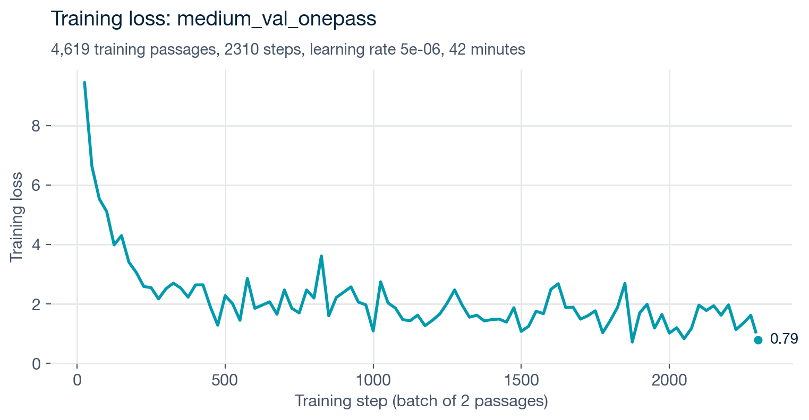
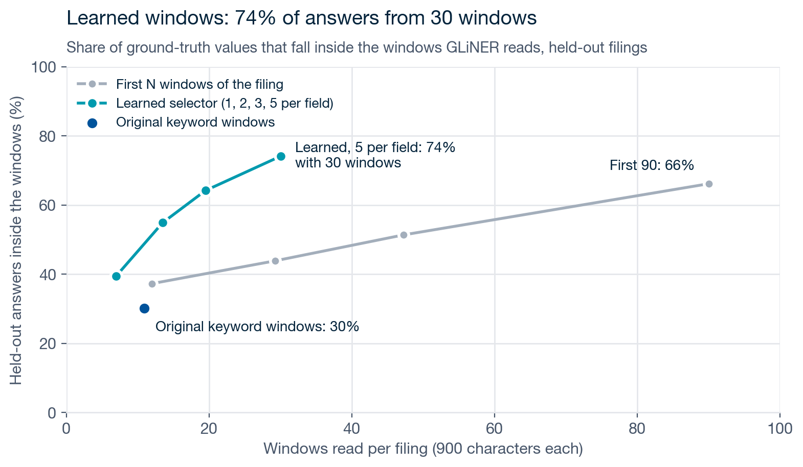
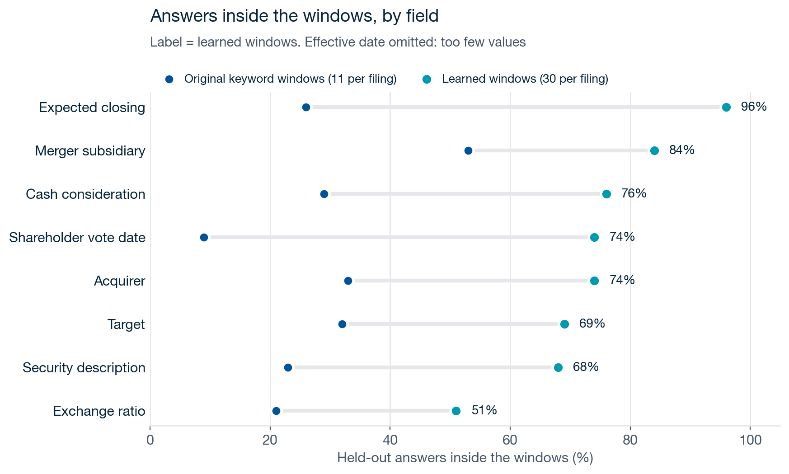
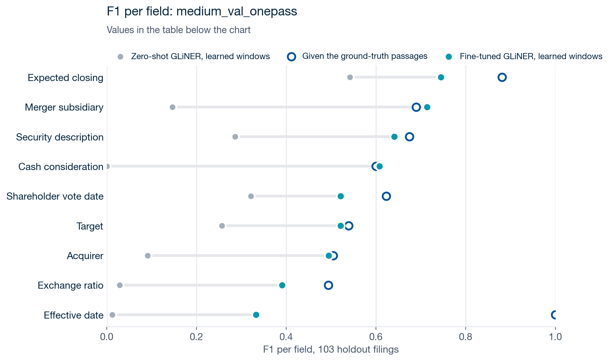
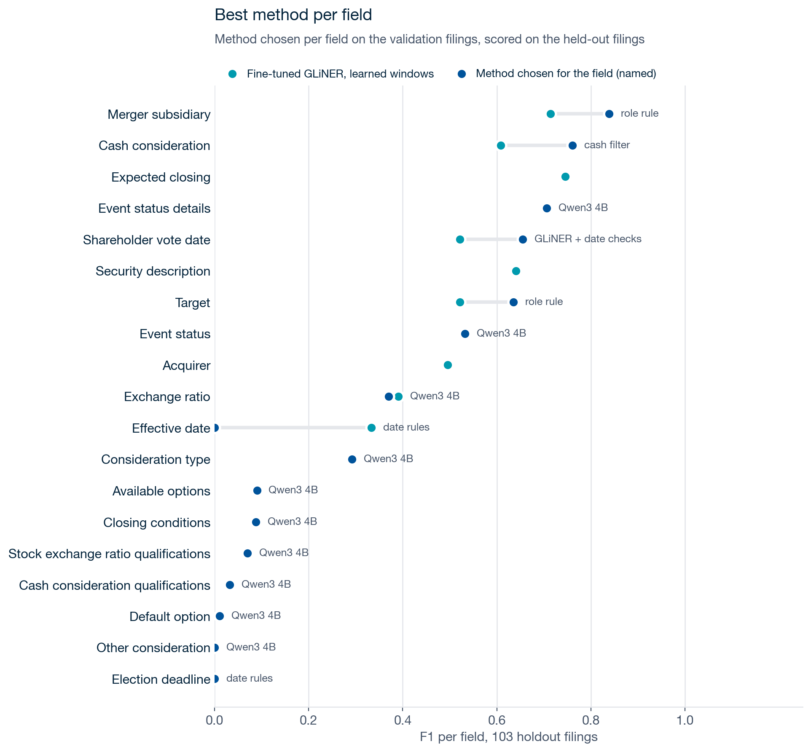

# Fine-tuning GLiNER for merger extraction

How we fine-tuned GLiNER to extract merger fields from SEC filings, how we chose which parts of each filing it reads, and how well it does now. Every number below comes from the files in `outputs/`. The charts are drawn from them by `make_figures.py`, and `visualize_mergers_results.ipynb` shows the same charts and tables for any run, including runs added later.

**Status, November 13, 2026, after the overnight run.** On 103 held-out filings and the 10 span fields:

| Setup | Micro-F1 | Wrong answers |
|---|---|---|
| Off-the-shelf GLiNER (zero-shot) | 0.19 | 1,202 |
| Fine-tuned GLiNER (`medium_val_onepass`), learned windows | 0.58 | 567 |
| **Combined pipeline: the best method per field, chosen on 52 validation filings** | **0.63** | **464** |

These scores measure agreement with LLM-extracted ground truth that nobody has checked yet, so they are not accuracy. Sections 6 and 8 describe the overnight fine-tune, section 9 the other methods and the combined pipeline, and section 11 what comes next.

**Terms used throughout.** GLiNER reads text in pieces of about 900 characters, called **windows**. A merger filing runs to hundreds of thousands or millions of characters, so only some of its windows can be read, and something has to choose which.

| Term | What GLiNER reads | Windows per filing |
|---|---|---|
| **Original keyword windows** (called `pipeline` in the result folders and the `--windows` option) | The choice made by the existing merger pipeline (`src/merger_gliner.py`), before this work: the start of the filing, plus the text around the first and last mention of 8 keyword patterns such as "merger consideration", "exchange ratio" and "special meeting" | About 11 |
| **Learned windows** | The choice made by `window_selection.py`: every filing is split into windows, each window is scored for each field by how much it looks like the windows that held that field's answer in the training filings (its words and its position in the filing), and the top 5 per field are read | About 30 (fields often pick the same windows) |
| **Ground-truth passages** | Only the passages the ground truth quotes as evidence. Not usable in practice, because it needs the answer's location; it shows what GLiNER scores when it reads the right text | One per quote |

Section 7 explains the learned windows in detail.



## 1. Ground truth

The ground truth is `notebooks/evaluation/data/merger_2026-01-01_2026-09-30/mergers.csv`, made by `load_merger_filings.ipynb`. An LLM reads each filing and returns the merger fields with exact supporting quotes.

- **Regenerated for this work.** The first version wrote sentences into the value fields (a median of 288 characters for cash consideration), which a span model cannot match. The prompt now asks for short values: names only, "$47.60 per share", "0.400 shares of X common stock per share", dates as M/D/YYYY. Caveats moved to seven new columns at the end of the table. The 13 original columns keep their names and order, because the downstream agents read them.
- **Coverage.** 600 filings from January to September 2026 gave 951 records from 573 filings. 23 filings returned no merger record, 3 were over the 4.5-million-character limit, and 1 timed out.
- **Unverified.** Every row is LLM output. Scores below are agreement with it.

## 2. Which fields GLiNER handles

GLiNER is a span model: it can only return text that appears in the filing. Fields were split the same way the tender-offer pipeline splits them.

| Group | Fields | Method |
|---|---|---|
| Span fields (fine-tuned) | acquirer, target, merger_subsidiary, security_description, cash_consideration, stock_exchange_ratio, shareholder_vote_date, effective_date, election_deadline, expected_closing | GLiNER |
| Identifiers | ticker, cusip, isin | Regex in the notebook, as in the tender pipeline |
| Derived categories | consideration_type, stock_exchange_ratio_type, mandatory_voluntary_indicator | Rules on the other fields |
| Summaries and status | event_status, closing_conditions, available_options, default_option, qualifications, other_consideration, event_status_details | Not fine-tuned; Qwen3 4B, a local LLM (section 9) |

Section 9 adds other methods for the span fields too (rules, filters and checks on GLiNER's candidates, temporal NER, Qwen), and the combined pipeline picks one method per field.

## 3. Baseline: zero-shot GLiNER

`gliner_zero_shot_eval.py` runs off-the-shelf `urchade/gliner_medium-v2.1` with plain-English labels such as "acquirer organization". On the held-out filings it scores 0.20 micro-F1. Its typical mistakes were defined terms and labels from the filing, chosen with high confidence: "Buyer", "Merger Sub", "Exchange Ratio", "Effective Time", tickers such as "FLYX", par values such as "$0.001", and deal totals.

## 4. Building the training data

`build_training_data.py` turns the ground truth into GLiNER training passages.

1. **Find the value in the filing.** For each record and span field, find the field's supporting quotes in the filing text, then find the value inside them. Formatting differences are allowed: "6/11/2026" matches "June 11, 2026", "$16.00 per share" matches "$16.00", and "1 share" matches "one (1) share".
2. **Cut a passage.** Take about 900 characters around each value, the same size GLiNER reads at inference.
3. **Label every value in the passage.** Every ground-truth value of that filing found in the passage is labelled, so a correct answer is never left unmarked.
4. **Add negatives.** Passages from the same filing that hold no values are added unlabelled. They teach the model that "Buyer" or "Exchange Ratio" is not an answer.

Values that cannot be found in the text produce no training data. Exchange ratios are often formulas ("$4.58 divided by Closing VWAP"), and every election deadline in the ground truth is relative wording ("Ten business days after the effective time").



## 5. Splitting by deal

One deal produces several filings: a 425, an S-4, a proxy, an 8-K. If they land on both sides of the split, the model is tested on wording it was trained on. Filings that share an SEC file number, a filer CIK or a target name form one deal group, and about 20% of groups are held out. The assignment is saved in `outputs/training_data/splits.csv` and kept as data is added, so the holdout never moves into training.

For the overnight run, about 15% of the training deal groups were set aside as a **validation set** (`common.make_validation`, a different hash from the holdout; saved in `outputs/training_data/validation_accessions.txt`). Every choice (checkpoint, method per field) is made on validation, so the held-out filings are scored once and stay an honest test.

| | Filings | Deal groups | Passages | Labelled spans |
|---|---|---|---|---|
| Training | 418 | 231 | 4,619 | 13,817 |
| Validation | 52 | 37 | 629 | 1,988 |
| Held out | 103 | 75 | 1,282 | 3,749 |

## 6. Fine-tuning

`train_gliner.py` fine-tunes `urchade/gliner_medium-v2.1` with the settings of the tender-offer fine-tune (`scripts/train_tender_gliner.py`): batch size 2, learning rate 5e-6 (1e-5 for the non-encoder layers), linear schedule with 10% warm-up, focal loss (α 0.75, γ 2).

**First fine-tune** (`medium_500steps_573filings`): 500 steps on all training filings, 8 minutes on the CPU. 500 steps saw only about a fifth of the passages. It scored 0.56 on the held-out filings (section 8).

**Overnight fine-tune** (`medium_val_onepass`, November 12, `run_overnight.sh`): validation filings left out, then one pass over the 4,619 training passages (2,310 steps), 42 minutes on the CPU, with a checkpoint every 500 steps. `select_checkpoint.py` scored each checkpoint on the validation filings and kept the best:

| Checkpoint | 500 | 1,000 | **1,500** | 2,000 | 2,310 (end) |
|---|---|---|---|---|---|
| Validation micro-F1 | 0.59 | 0.64 | **0.66** | 0.65 | 0.65 |

Validation stopped improving after 1,500 steps, so checkpoint 1,500 is the model (`models/merger_gliner/medium_val_onepass/final`). Training past one pass is not worth it with LLM labels: the model would start learning their errors.

Two practical points:

- **Every passage carries all 10 labels**, as at inference. Without this, GLiNER fails on a batch made only of negative passages, and the model never learns that a field can be absent.
- **Train on the CPU** (`--use-cpu`). On the Mac GPU (MPS), memory grew with every step and training failed around step 100 each time; the CPU was about as fast.



## 7. Choosing which windows to read

A merger filing has hundreds of thousands to millions of characters, and GLiNER reads about 900 at a time, so something has to choose what it reads. The existing pipeline (`src/merger_gliner.py`) reads around the first and last hit of 8 keyword patterns, about 11 windows per filing. Those windows held only 30% of the held-out answers.

`window_selection.py` learns the choice instead, from the training filings only:

1. Split each filing into overlapping 900-character windows.
2. Mark the windows that contain each field's ground-truth value.
3. For each field, learn which words, two-word phrases ("special meeting", "right to receive") and positions in the filing mark those windows. It is a naive-Bayes score, limited to the 150 most telling features that appear in answer windows of at least 5 different deals (so one deal's company names and tickers do not count). Position matters: about 75% of party-name quotes sit in the first 10% of the filing, in the proxy summary.
4. For a new filing, read the top 5 windows per field. Fields often pick the same windows, so this averages 30 windows.



The learned windows hold 74% of the held-out answers from 30 windows. Reading the first 90 windows of each filing gets 66%.

The most telling words it learned are general merger wording: "without interest", "in cash" and "receive per" for cash; "held virtually", "am eastern" and "online via" for the vote date; "date depends" and "when do" (from "When do you expect the merger to be completed?") for expected closing; the proxy cover letter ("dear … enclose") for the acquirer and target. They are listed per field in `outputs/window_selector/top_features.json`.



How the settings were chosen. The first version used every word and did no better than reading the start of the filing; limiting it to 150 features seen in at least 3 answer windows was decided after a look at the first 26 held-out filings, so those filings had a small influence on the design. That version still learned company names from individual training deals ("hpst", "aptose", "devon"), which mean nothing on a new filing, so words now also have to appear in answer windows of at least 5 different deals. That rule was chosen from the learned word lists, not from held-out scores, and raised coverage from 65% to 74% and fine-tuned micro-F1 by 0.02.

## 8. Results

`gliner_finetuned_eval.py` scores each model on the 103 held-out filings. It takes the top-scoring span per field and filing and compares it with every ground-truth record of that filing:

- **Names** are compared without suffixes such as "Inc." or "Corp.". A generic role such as "Parent" or "Merger Sub" never counts as correct.
- **Cash and ratios** are compared as numbers, and **dates** as dates. For ratios, number words count: "one (1) share" matches 1.
- **Security description and expected closing** need at least half their words in common.
- **Stated absences** such as "No cash consideration" are counted apart, because a span model cannot produce them.

**Scoring correction, November 11.** The first scores read only digits, so an answer of "one" (from "one (1) share of PubCo") was marked wrong against "1 share … per share". Fixing this turned 36 held-out exchange-ratio answers from wrong to right: exchange ratio rose from 0.12 to 0.39 and micro-F1 from 0.53 to 0.56. All saved runs were rescored from their saved predictions (`rescore_all.py`); no model was rerun.

The "ground-truth passages" column is a reference point: GLiNER reads only the passages the ground truth quotes. It shows what perfect window choice would give, though not exactly. Those passages are pooled across fields, so for some fields the model picks a span from another field's passage and scores below the learned windows.



The overnight model (`medium_val_onepass`) is in the bold column; the first fine-tune is kept for comparison.

| Field | Zero-shot, learned windows | First fine-tune, learned windows | Overnight, original keyword windows | **Overnight, learned windows** | Overnight, ground-truth passages |
|---|---|---|---|---|---|
| Expected closing | 0.54 | 0.79 | 0.39 | **0.75** | 0.88 |
| Merger subsidiary | 0.15 | 0.68 | 0.61 | **0.71** | 0.69 |
| Security description | 0.29 | 0.64 | 0.66 | **0.64** | 0.68 |
| Cash consideration | 0 | 0.46 | 0.59 | **0.61** | 0.60 |
| Target | 0.26 | 0.52 | 0.50 | **0.52** | 0.54 |
| Shareholder vote date | 0.32 | 0.47 | 0.53 | **0.52** | 0.62 |
| Acquirer | 0.09 | 0.50 | 0.52 | **0.50** | 0.51 |
| Exchange ratio | 0.03 | 0.39 | 0.47 | **0.39** | 0.49 |
| Effective date | 0.01 | 0.06 | 1.00 | **0.33** | 1.00 |
| Election deadline | 0 | — | — | **—** | 0 |
| **Micro-F1** | 0.19 | 0.56 | 0.54 | **0.58** | 0.63 |

Effective date has 1 held-out value and election deadline 4, so their F1 says little: the overnight model gets the one effective date right, with 4 wrong answers (the first fine-tune had 33).

**What the results show**

- **Fine-tuning is the main gain:** 0.19 to 0.56 with the first fine-tune, 0.58 after the overnight run. It removed most of the defined-term and ticker answers.
- **More training mostly bought precision.** The overnight model gives about the same number of right answers (625 against 627) but fewer wrong ones (567 against 641): cash consideration rose from 0.46 to 0.61, and wrong effective dates fell from 33 to 4.
- **Learned windows beat the original keyword windows by 0.04 overall** (0.58 against 0.54), and by 0.36 on expected closing, because the keyword windows rarely reach the "expected to close" sentences. On exchange ratio the keyword windows do better (0.47 against 0.39): they read the "Exchange Ratio" definition directly.
- **GLiNER finds most answers but also tags wrong ones.** Cash consideration and vote date each find over 80% of the held-out values, but are right only about half the time they answer (deal totals and other prices; other dates in the meeting notice). Section 9 adds checks on GLiNER's candidates for exactly this.
- **Exchange ratio** stays at 0.39: fixed ratios are found ("0.2236", "one (1) share"), but only about half its values appear in the text at all, because many are formulas ("$4.58 divided by Closing VWAP").

The first fine-tune, on 146 filings with a 26-filing holdout, scored 0.40 with original keyword windows. That holdout is smaller and different, so it is not directly comparable, but the direction matched.

## 9. Other methods and the combined pipeline

Fine-tuned GLiNER is one method among several. Each method below writes its scores in the same format (`common.write_results`), on the validation and the held-out filings, so they can be compared field by field. Most of them do not replace GLiNER: **GLiNER proposes the candidate spans, and checks decide** which candidate is the answer, or that there is none. The candidates are cached once per model (`gliner_candidates.py`, `outputs/methods/gliner_candidates/<model>.jsonl`), so a check can be changed and rescored without rerunning GLiNER.

| Method | Script | Fields | What it does |
|---|---|---|---|
| Cash filter | `cash_filter.py` | Cash consideration | GLiNER's amounts, keeping only a per-share merger price: drops totals ("$500 million"), par values, trust-account, redemption, exercise and trading prices, fees. Blank when nothing passes (stock-only deals) |
| Role rule | `role_rule.py` | Acquirer, target, merger subsidiary | Reads the merger agreement: the conversion clauses ("each share of X … converted into the right to receive … shares of Y" gives target X, acquirer Y), then the party definitions ("Parent", "Merger Sub", "the Company"), then the filer by form. Uses the acquirer and target definition in the README |
| GLiNER + role checks | `gliner_roles.py` | Acquirer, target, merger subsidiary | The same structure as the role rule, but it only assigns roles to GLiNER's party names; a defined party's legal name is added only when GLiNER missed that company |
| Ratio rule | `ratio_rule.py` | Exchange ratio | Classifies the deal from the filing text: no stock (leave blank), formula ratio (quote the formula as "Formula: …"), or fixed ratio (keep GLiNER's number) |
| GLiNER + date checks | `gliner_dates.py` | Vote date, effective date, election deadline | GLiNER's date spans, kept only if the date fits the filing and its sentence is about the right event (a meeting; a completed merger in a completion filing; a consideration election). Blank unless one date holds 60% of the support |
| Date rules | `date_rules.py` | Vote date, effective date, election deadline | Wording patterns for the same three dates, written from training filings |
| Temporal NER | `temporal_dates.py` | The dates and expected closing | A date tagger (`satyaalmasian/temporal_tagger_BERT_tokenclassifier`) finds date expressions, the date-rule wording assigns the role |
| Qwen3 4B | `qwen_fields.py` | Exchange ratio, dates, and every summary and status field | A local LLM (through Ollama) reads the learned and keyword windows and answers in the ground truth's format |

**The combined pipeline** (`pipeline.py`) picks, for each field, the method with the best validation score (F0.5 for dates, which weighs a wrong date twice as much as a blank; F1 otherwise), then scores that choice once on the held-out filings. Ties go to the higher precision, then to fewer wrong answers, then to the method listed first.



| Field | Method chosen on validation | Validation F1 | Held-out F1 | Fine-tuned GLiNER alone, held-out |
|---|---|---|---|---|
| Merger subsidiary | Role rule (tied exactly with GLiNER + role checks) | 0.93 | **0.84** | 0.71 |
| Cash consideration | Cash filter | 0.54 | **0.76** | 0.61 |
| Expected closing | Fine-tuned GLiNER | 0.79 | **0.75** | 0.75 |
| Shareholder vote date | GLiNER + date checks | 0.76 | **0.66** | 0.52 |
| Security description | Fine-tuned GLiNER | 0.65 | **0.64** | 0.64 |
| Target | Role rule | 0.84 | **0.64** | 0.52 |
| Acquirer | Fine-tuned GLiNER | 0.76 | **0.50** | 0.50 |
| Exchange ratio | Qwen3 4B | 0.36 | **0.37** | 0.39 |
| Effective date | Date rules | 1.00 (2 values) | **—** (1 value, missed) | 0.33 |
| Election deadline | Date rules | 0.50 (2 values) | **0** (4 values) | — |
| **10 span fields, micro-F1** | | | **0.63** (464 wrong) | 0.58 (567 wrong) |
| Event status details | Qwen3 4B | 0.63 | 0.71 | |
| Event status | Qwen3 4B | 0.59 | 0.53 | |
| Consideration type | Qwen3 4B | 0.16 | 0.29 | |
| Available options, default option, closing conditions, qualifications, other consideration | Qwen3 4B | 0 to 0.13 | 0 to 0.09 | |

**What the combined pipeline shows**

- **Checks on GLiNER's candidates work where GLiNER finds the answer but picks wrong ones.** The cash filter (0.61 to 0.76) and the date checks on the vote date (0.52 to 0.66) keep GLiNER's recall and remove most of its wrong answers.
- **The merger agreement's structure fixes the merger subsidiary and the target** (0.71 to 0.84, 0.52 to 0.64).
- **The acquirer is not settled.** On the held-out filings, the role rule scores 0.83 and GLiNER + role checks 0.81, against 0.50 for GLiNER alone, but GLiNER won on validation (0.76 against 0.69 and 0.66), so the pipeline uses GLiNER. Two reasons, both in section 10: the validation set is small (37 deals), and the ground truth was labelled before we fixed the acquirer definition, so in SPAC deals it names the SPAC or the operating company where the rule names the new holding company. The conversion-clause part of the role rule was also written while reading held-out errors, so its 0.83 is not an unseen test.
- **The exchange ratio needs formula support in the scorer.** The ratio rule scores 0.49 on the held-out filings, the best of any method, but 0.34 on validation, behind Qwen (0.36). The scorer compares numbers, so a "Formula: …" answer can never count as right, even when the ground truth is a formula.
- **Effective date and election deadline cannot be measured yet:** the held-out filings have 1 effective date and 4 election deadlines, the validation filings 2 and 2. Only 3 of the 113 8-Ks in the sample report a completed merger. Choosing a method for these needs more filings that contain them (section 11).
- **The summary fields are weak with Qwen3 4B** (under 0.15 for options, conditions and qualifications). It answers almost every time, including when the ground truth has nothing, so most of its answers count as wrong.

## 10. Limitations

- **Unverified ground truth.** All scores are agreement with LLM output. A hand-checked sample of the held-out filings is needed before calling any number accuracy.
- **Old acquirer and target labels.** The ground truth was labelled before the acquirer and target definition in the README (November 12). The notebook prompt now has it, but the labels are not regenerated yet, so the acquirer and target scores partly measure the old convention.
- **Small validation set.** 52 filings from 37 deals choose the method per field. Close calls between methods (acquirer, exchange ratio, merger subsidiary) can go either way.
- **Too few dates.** 1 held-out effective date and 4 election deadlines; F1 on them is not meaningful.
- **Top-1 per filing.** One prediction per field is compared with every record of a filing, so a filing about two deals or two share classes can never score fully.
- **Missing filings.** 27 of the 600 filings give no training or test data (23 without a merger record, 4 not extracted).
- **Lenient text matching** for security description, expected closing and the summary fields (half the words in common).

## 11. Next steps

| Order | Work | Detail |
|---|---|---|
| 1 | **Regenerate the ground truth on more filings** | Rerun `load_merger_filings.ipynb` with the updated prompt (acquirer and target definition) on about 1,200 filings. The loader now also runs two targeted searches (`targeted` in `corporate_actions.json`): up to 200 completion 8-Ks (Item 2.01, which state the effective date) and up to 120 filings that state an election deadline for the merger consideration. They take their slots first, and the general merger search fills the rest |
| 2 | **Retrain and rerun everything** | `build_training_data.py`, then `NAME=<new name> zsh mergers_extraction/run_overnight.sh`. The split keeps today's held-out deals held out; the new filings add to both sides. With the new labels, the acquirer and target scores measure the definition we chose |
| 3 | **Dates and deadlines** | With enough completion and election filings, compare GLiNER + date checks, temporal NER and the date rules on validation, and research a method for relative deadlines ("five business days before the closing") |
| 4 | **Acquirer and target** | Settle the role rules on the new labels: GLiNER + role checks against the role rule, compared on validation |
| 5 | **Exchange ratio** | Credit "Formula: …" answers when the ground truth is a formula (`stock_exchange_ratio_type`), rescore every method from saved predictions (`rescore_all.py`), then rerun the routing |
| 6 | **Summary fields** | A stricter Qwen prompt: first confirm that the term exists in the filing, then answer with a quote; tested on validation |
| Ongoing | **Hand-check 20 to 30 held-out filings** | So the scores measure accuracy, not agreement with the LLM |

## Reproduce

Everything, from the repository root with the project `.venv` (about 2 hours on a laptop CPU, Qwen answers cached):

```bash
.venv/bin/python mergers_extraction/build_training_data.py     # after a new ground-truth run
NAME=medium_val_onepass zsh mergers_extraction/run_overnight.sh
```

`run_overnight.sh` makes the validation split, fine-tunes for one pass with checkpoints, chooses the checkpoint on validation, scores it on the held-out filings, runs every method on validation and held-out filings, builds the combined pipeline, and redraws the charts. The log is in `outputs/logs/overnight_<date>.log`. Qwen needs Ollama running (`ollama serve`, `ollama pull qwen3:4b`).

| Output | Where |
|---|---|
| Training data, split, validation set and coverage | `outputs/training_data/` |
| Model weights and checkpoint scores (gitignored) | `models/merger_gliner/medium_val_onepass/` |
| Training settings and loss | `outputs/gliner_finetuned_medium_val_onepass_holdout/train_meta.json` |
| Fine-tuned GLiNER scores and every prediction | `outputs/gliner_finetuned_medium_val_onepass_{holdout,validation}/` |
| GLiNER candidate spans | `outputs/methods/gliner_candidates/` |
| Other methods | `outputs/methods/<method>_holdout/`, validation in `outputs/methods/validation/` |
| Combined pipeline: routing, scores, predictions | `outputs/pipeline/combined_medium_val_onepass_holdout/` |
| Window selector and its coverage | `outputs/window_selector/` |
| Charts | `figures/` |
