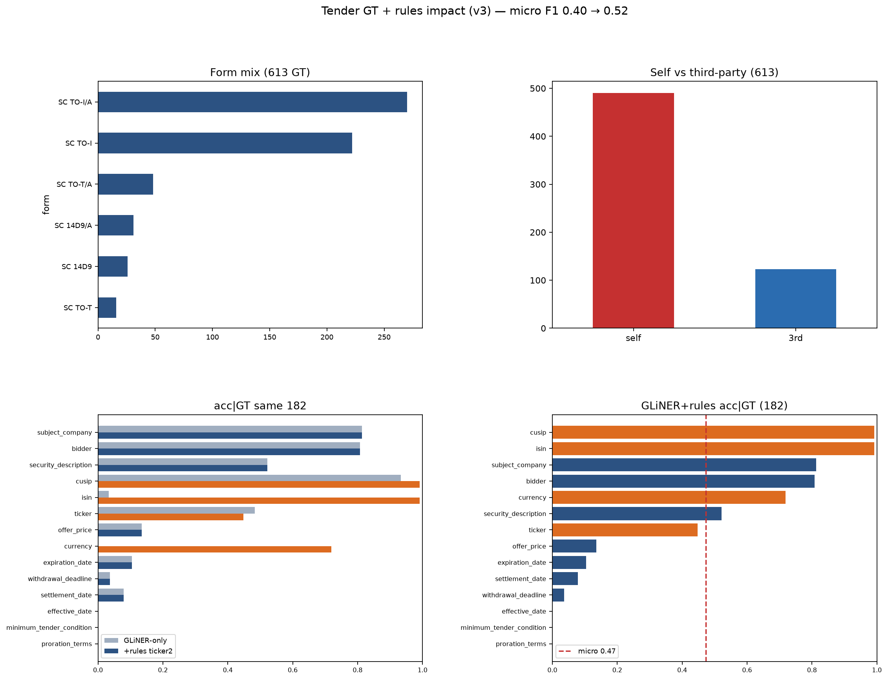
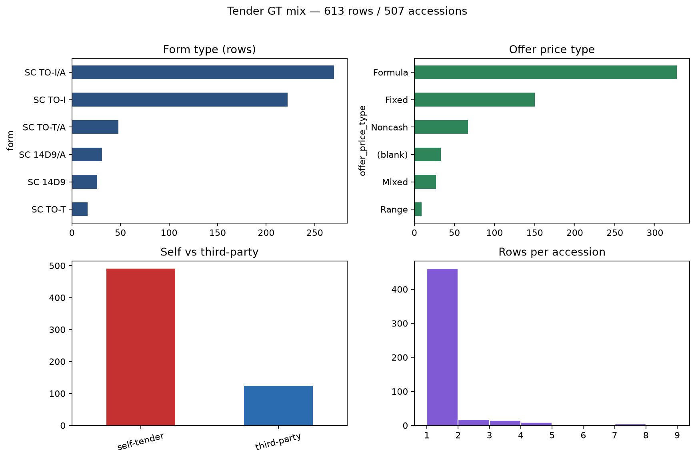
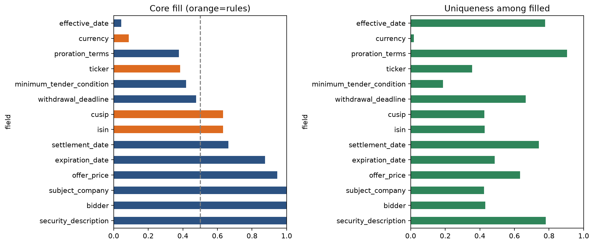
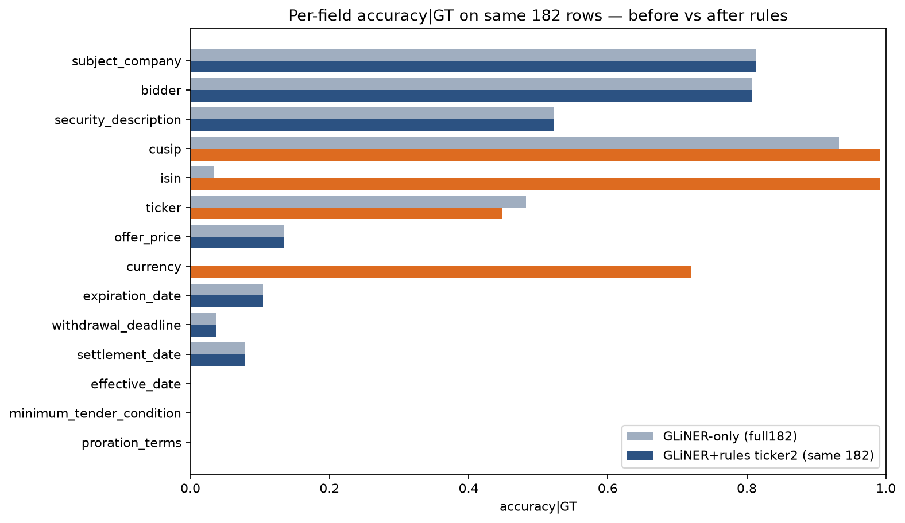
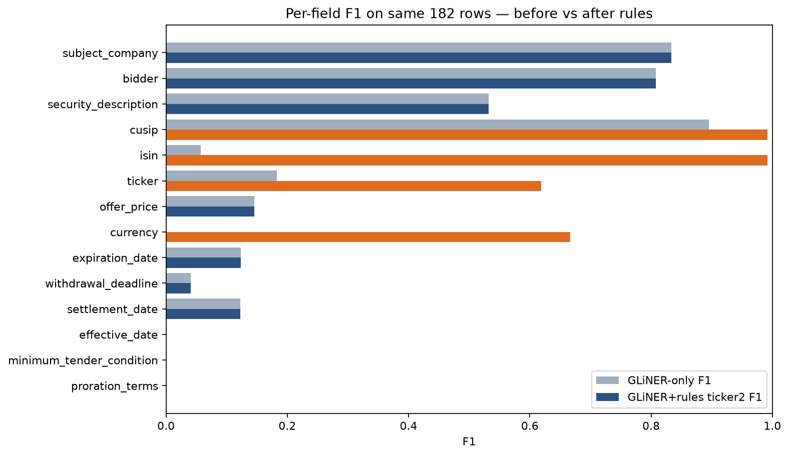
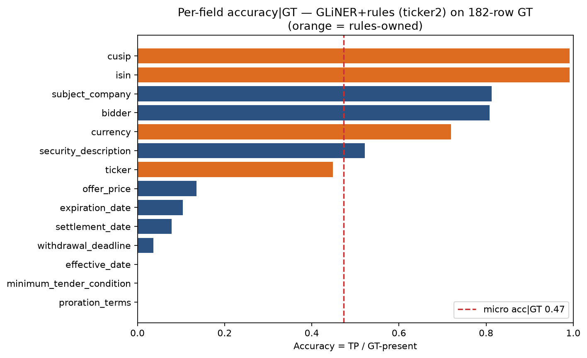

# Tender GT fetch plan (for GLiNER)

> Plot paths are stamped `_v3` to avoid stale Markdown preview caches. If an image looks wrong, hard-refresh the preview.

**Comparable eval (same 182 rows / 100 accessions, 0 missing preds):**  
`full182_ft_medium_t0.35` (GLiNER-only) → `rules_ids_full182_ticker2` (GLiNER + rules, improved ticker regex)

| Metric | GLiNER-only | + rules (ticker2) |
|---|---:|---:|
| Micro precision | 0.459 | **0.584** |
| Micro recall | 0.358 | **0.474** |
| Micro F1 | 0.402 | **0.523** |
| Micro accuracy\|GT | 0.358 | **0.474** |

**Per-field on those same 182 rows:**

| Field | Owner | acc\|GT before → after | F1 before → after |
|---|---|---|---|
| subject_company | GLiNER | 0.813 → 0.813 | 0.834 → 0.834 |
| bidder | GLiNER | 0.808 → 0.808 | 0.808 → 0.808 |
| security_description | GLiNER | 0.522 → 0.522 | 0.532 → 0.532 |
| cusip | **Rules** | 0.933 → **0.992** | 0.895 → **0.992** |
| isin | **Rules** | 0.034 → **0.992** | 0.057 → **0.992** |
| ticker | **Rules** | 0.483 → 0.448 | 0.183 → **0.619** |
| offer_price | GLiNER | 0.135 → 0.135 | 0.146 → 0.146 |
| currency | **Rules** | 0.000 → **0.719** | — → **0.667** |
| expiration_date | GLiNER | 0.104 → 0.104 | 0.124 → 0.124 |
| withdrawal_deadline | GLiNER | 0.037 → 0.037 | 0.041 → 0.041 |
| settlement_date | GLiNER | 0.079 → 0.079 | 0.123 → 0.123 |
| effective_date | GLiNER | 0.000 → 0.000 | — |
| minimum_tender_condition | GLiNER | 0.000 → 0.000 | — |
| proration_terms | GLiNER | 0.000 → 0.000 | — |

Ticker note: acc|GT dipped slightly because rules **abstain** more (fewer wrong guesses); **F1 rose** (0.18→0.62) via precision 1.0 and better recall from OTC / `under the symbol “…”` / `COY:` patterns.

Rules code: `src/preprocess/rules_ids.py`.

**Full Evaluation GT** (fetch / diversity): `tender_offers.csv` — **613 rows / 507 accessions** (~80% TO-I / self-tender).

## Plots (`figures/*_v3.png`)

### Dashboard

### GT mix (613)

### Before vs after on 182 (accuracy|GT)

Gray = GLiNER-only · blue = GLiNER · orange = rules.

### Before vs after on 182 (F1)

### Accuracy after rules (182)

## What to fetch (GLiNER-owned fields only)

| Fetch priority | What to pull | Target mix (aim) | Why | Fields it unlocks |
|---|---|---|---|---|
| **P0** | **SC TO-T / SC TO-T/A** third-party tenders | ≥25–30% of accessions | Breaks self-tender / TO-I monopoly | bidder ≠ subject, fixed cash, security_description |
| **P0** | **Fixed-price cash offers** | ≥30% of rows | Clean short price spans | offer_price |
| **P0** | Short **expiration + withdrawal** clock times | OTP/FAQ wording | Dates still ~0.04–0.10 on 182 | expiration_date, withdrawal_deadline |
| **P1** | Older years (2023–2025) | ≥2 calendar years | Avoid 2026-only overfit | dates, parties, price |
| **P1** | Cover more of 507 Evaluation accessions in preprocess | — | Full-GT metrics otherwise look low | all |
| **Skip for GLiNER** | cusip / isin / ticker / currency | — | Rules-owned | rules pipeline |
| **Skip** | Long proration / conditions as spans | — | Wrong task for GLiNER | LLM later |

## Takeaway

- On the **same 182**, subject_company did **not** drop (0.813 both ways).
- Rules fixed **ISIN** (0.03→0.99) and **currency** (0→0.72); **ticker F1** 0.18→0.62.
- Remaining GLiNER gaps: offer_price, dates, min-tender, proration — need balanced fetch + short spans.
